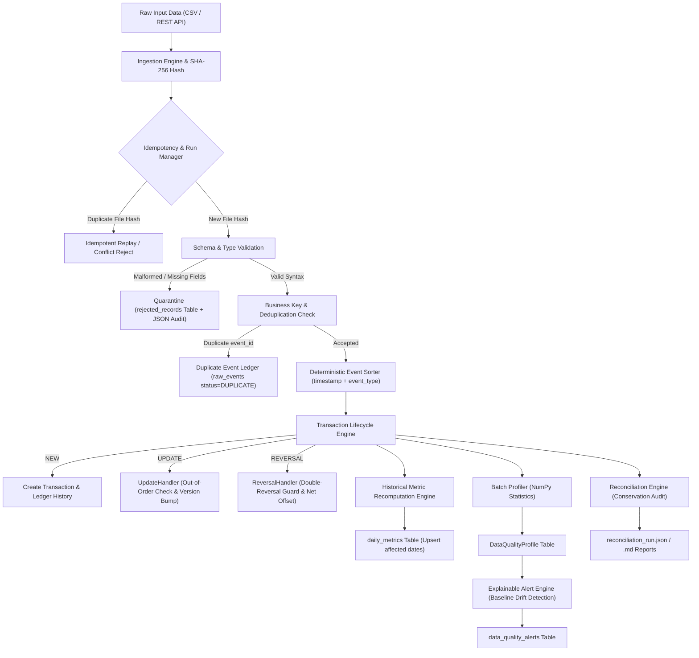

# YottaFlex AI Data Engineering Solution – Architecture

## 1. System Overview

The YottaFlex AI Data Engineering platform is an enterprise-grade, deterministic, locally runnable transaction processing system designed to maintain daily product and customer metrics from incremental, multi-source event streams.

The architecture guarantees:
- **Strict Data Conservation**: Every ingested row receives exactly one terminal classification ($N_{input} = N_{accepted} + N_{rejected} + N_{duplicate}$).
- **State Integrity**: Transaction updates and reversals are deterministic and immune to double-counting or double-reversals.
- **Out-of-Order Resilience**: Older arriving events never overwrite newer confirmed transaction states.
- **Historical Accuracy**: Late-arriving events trigger targeted business-date metric recomputations without full-table reloads.
- **Idempotent Ingestion**: SHA-256 payload hashing and transactional boundaries ensure re-running batches is safe and non-duplicating.
- **Explainable Observability**: Statistical baselines track volume, null rates, and monetary drift with human-interpretable root causes.

---

## 2. Component Architecture

### 2.1 Ingestion & Idempotency Layer (`app/ingestion/`)
- **`loader.py`**: Reads raw CSV files, enforces required column headers, tracks 1-based source line numbers, and computes SHA-256 content hashes.
- **`batch_manager.py`**: Coordinates the lifecycle of ingestion runs (`ProcessingRun`). Enforces idempotency:
  - If a file hash matches a previously `COMPLETED` run, it rejects re-ingestion with HTTP 409 / `DuplicateFileError` unless `allow_rerun=True` is explicitly authorized.
  - If a previous run `FAILED`, it enables safe retry without leaving dangling state.

### 2.2 Validation & Quarantine Layer (`app/validation/`)
- **`schema_validator.py`**: Verifies column presence, non-null constraints, event types (`NEW`, `UPDATE`, `REVERSAL`), positive amounts ($> 0.00$), 3-letter currency codes, and strict ISO-8601 UTC timestamp parseability.
- **`business_validator.py`**: Validates customer ID and product ID reference formats against allowable character patterns. Checks `event_id` uniqueness against both the in-flight batch and historical `raw_events`.
- **`quarantine.py`**: Quarantines rejected records directly to the `rejected_records` database table and exports a JSON audit log (`data/rejected/{run_id}_rejected.json`). Records retain the original line number, full raw string, rejection reason, and standard error code.

### 2.3 Transaction Lifecycle Engine (`app/processing/`)
- **`transaction_processor.py`**: Sorts accepted events deterministically by `(event_timestamp, priority)` where priority order is `NEW (0) -> UPDATE (1) -> REVERSAL (2)`. Dispatches events to specialized handlers, collects affected business dates, and coordinates recomputations.
- **`update_handler.py`**: Locates existing transactions. If an event is older than the latest confirmed state (`event_timestamp < latest_event_timestamp`), the update is recorded as superseded in `transaction_history` without downgrading the transaction amount. If newer, it updates `current_amount`, updates `latest_event_timestamp`, and increments `version`.
- **`reversal_handler.py`**: Sets transaction `status="REVERSED"`, `is_reversed=True`, and reduces effective contributing amount to `$0.00`. If a transaction is already reversed, it prevents double-reversals.
- **`recomputation.py`**: Queries transactions whose business date (`func.date(first_event_timestamp)`) matches affected dates. Aggregates total transactions, total amount, distinct customers, distinct products, average amount, min, max, null rates, and freshness, updating `daily_metrics` idempotently.

### 2.4 Baseline Profiling & Alert Engine (`app/profiling/`, `app/alerts/`)
- **`baseline.py`**: Version-controlled historical baselines (`BaselineProfile`) containing expected record volume, null rate, and amount distribution quantiles.
- **`profiler.py`**: Evaluates batch-level metrics (mean, std, min, max, median, p95, null rate, event freshness) into `DataQualityProfile`.
- **`alert_engine.py`**: Evaluates percentage drops in volume, percentage-point spikes in null/quarantine rates, and mean amount drift. Generates explainable `DataQualityAlert` entries with plain-language explanations and suggested operational remediation. Avoids duplicate alerts for identical `(run_id, metric_name)` pairs.

### 2.5 Observability & Reconciliation Layer (`app/reporting/`)
- **`reconciliation.py`**: Enforces strict mathematical accounting:
  $$\text{Input Rows} = \text{Accepted Rows} + \text{Rejected Rows} + \text{Duplicate Rows}$$
  Cross-checks persistent DB row counts and compares accepted raw event sum against the initial transaction ledger.
- **`report_generator.py`**: Produces machine-readable JSON and human-readable Markdown reconciliation and performance audit reports in `reports/`.

---

## 3. Database Schema

The database relies on 10 relational tables in SQLAlchemy 2.0:
1. `data_sources`: Source systems registry (Payment gateway, eCommerce, POS).
2. `processing_runs`: Batch run tracking with execution duration and terminal counts.
3. `raw_events`: Complete audit log of every accepted and duplicate event with raw payloads.
4. `transactions`: Current dimensional state of business transactions.
5. `transaction_history`: Append-only immutable log of every state change and superseded event.
6. `daily_metrics`: Daily aggregated business and data quality metrics.
7. `baseline_profiles`: Versioned operational baselines.
8. `data_quality_profiles`: Per-batch data quality and statistical profiles.
9. `data_quality_alerts`: Actionable, explainable anomaly alerts.
10. `rejected_records`: Quarantined invalid records with line numbers and root causes.
11. `processing_errors`: Unhandled system/pipeline exceptions with stack traces.

